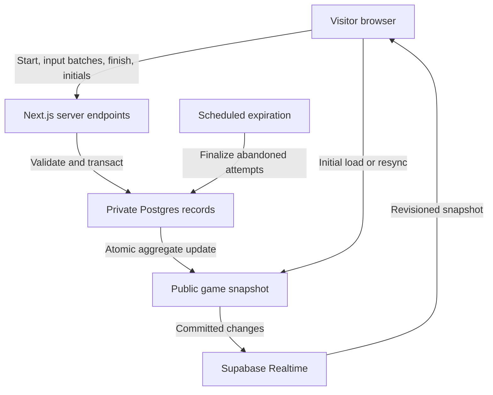
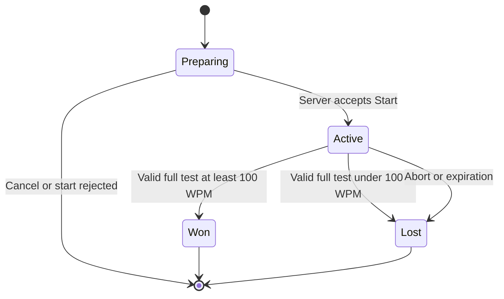

# Typing game backend and realtime data

Status: Supabase Free is the selected backend. Detailed implementation remains proposed. No database, endpoint, or account has been created.

## Selected backend

Use **Supabase Free**, selected by Sebastian, which includes a Postgres database. The proposed implementation uses it for durable attempts/results, Realtime, scheduling, and the owner dashboard. This is one backend provider, not separate Supabase and Postgres services. Use transactions for counters, expiration, ranking, and duplicate prevention. The $0 budget rules out paid plans and automatic upgrades.

Upstash Redis Free was evaluated as an alternative primary database and was not selected. The [free backend comparison](../research/free-backend-comparison.md) preserves the tradeoffs. Do not add a Redis instance to this initial architecture.

Supabase's documentation recommends Broadcast for greater scale; Postgres Changes is the simpler option. For this portfolio, propose Postgres Changes on **one deliberately public, sanitized current-state record**, not on raw attempts. It contains lifetime totals plus the current month's active-ruleset board. Evaluate Broadcast if needed within free limits. [Realtime choices](https://supabase.com/docs/guides/realtime/subscribing-to-database-changes).

## Trust and data flow

The browser cannot write scores/counters/initials directly to public database tables. It can read only the public snapshot via a constrained read policy or the snapshot API. Sensitive records, raw operations, session identifiers, limiter data, and analytics are not published to Realtime.

## Proposed records

| Record | Important data | Visibility |
| --- | --- | --- |
| `typing_rules` | Immutable version, 30-word passage length, normalization/scoring versions, threshold, abandonment timeout | Safe current settings can be public |
| `typing_attempts` | Opaque ID, browser-session binding, start idempotency key, assigned passage ID/text, word/character counts, rule version, scheduled start, abandonment deadline, validated elapsed/completion time, completion month, state, score, accuracy, reason | Server only |
| `typing_input_batches` | Attempt ID, sequence, bounded normalized edit operations and timing envelope, content hash, arrival time | Server only; short retention |
| `leaderboard_periods` | Calendar month ID, timezone, start/end instants, rule version, archive status | Server-managed; safe period metadata can be public |
| `leaderboard_entries` | Unique winning attempt ID, period/rule IDs, validated initials, score, accuracy, completion time, claim state | Server only; publish current month's sanitized top 10 |
| `game_totals` | Lifetime starts, wins, losses, pending across monthly resets; independent of leaderboard entries | Server only; safe counts copied to public snapshot |
| `public_game_state` | Current rule/month, reset instant, lifetime totals, sanitized monthly top-10 JSON, monotonic revision, updated timestamp | Public read, server write |
| `request_limits` | Short-lived keyed request windows and counts, if using the SQL limiter | Server only |

Use database constraints for unique start keys, batch sequences, and leaderboard attempts; validate `won` and score at least 100 again in the claim transaction. Store scoring inputs sufficient for validation, not unrestricted keylogs. Do not retain submitted data unrelated to the generated prompt. Proposed retention: delete detailed input batches after 7 days unless flagged for a short review; retain compact monthly results and accounting data within the free storage budget. Archive reconciled older counters before pruning attempts; never delete the only basis for checking lifetime totals.

## Lifecycle

1. **Prepare locally:** load the game, show rules, establish an anonymous browser session, load sound if enabled, and check readiness. No counted attempt yet.
2. **Accept Start:** enforce request limits, origin/session checks, and any required server-verified Turnstile challenge. In one transaction, check the ranked-start setting, create the attempt, and increment `total_starts` and `pending`. Return the existing result for a repeated idempotency key with the same payload even when new starts are paused. A changed payload using that key is rejected. [Degraded operation](release-operations.md#monitoring-and-degraded-operation)
3. **Schedule timing:** proposal is a 3-second countdown after acceptance, then elapsed-time passage entry. Persist the scheduled start and an abandonment deadline, proposed 120 seconds later, with a 15-second final transport grace. The timeout is not the test duration. Sync a monotonic client clock to server timing bounds; device wall-clock changes do not extend deadlines.
4. **Run:** the server assigns a normalized 30-word passage from a versioned pool. Submit bounded sequenced input batches, proposed every 5 seconds, retaining unacknowledged batches for retry. Freeze and flush immediately on passage completion; short tests need not wait for a checkpoint interval. Rendering/input/audio never wait for batch responses.
5. **Finish:** reconstruct operations and require the complete normalized target under the proposed correction rule. Validate reported final-input timing against server start, receipt times, and previous checkpoint envelopes, including a bounded network allowance. Compute WPM from passage character count and validated elapsed time; do not use the timeout as denominator. The same validated completion instant determines the leaderboard month. Neither client timestamps nor checkpoint logs prove honest human input.
6. **Finalize once:** lock/compare the pending row. A valid completed result becomes won or lost; decrement pending and increment the lifetime result counter atomically. Duplicated finish requests return the existing outcome. Only a verified win that currently ranks in its month's top ten can issue a claim ticket, including on an empty board.
7. **Expire:** a scheduled database job settles still-pending attempts past their finalization deadline as losses. An explicit abort can settle sooner. An invalid final submission earns no rank; a counted attempt remains pending until a correct retry or becomes a loss at expiry. Do not convert a failed unauthenticated request into a result for someone else's attempt.

“Active” includes the counted countdown, passage entry, and bounded result-delivery grace. Closing a tab or losing a network request cannot delete the attempt. Unload beacons are an optimization, never the source of truth. A short focus change does not pause elapsed time or automatically terminate the attempt.

Supabase Cron supports sub-minute scheduling; propose a bounded expiration/period-maintenance sweep every 10 seconds. Monitor runs, process indexed batches, and make retries safe. An abandoned attempt settles no later than approximately its 120-second deadline plus transport grace and one sweep while services are available. Retain only bounded cron execution history so frequent no-op jobs do not consume the free database. If Supabase is paused/quota-limited, catch up expired attempts on restoration; do not promise timely updates during an outage. Neither Vercel Hobby's legacy daily Cron Jobs nor its new Schedules beta (minimum recurring interval 15 minutes) can substitute for this frequent sweep. See [Hobby limits](../research/vercel-hobby-limits.md) and [Supabase Cron](https://supabase.com/docs/guides/cron).

## Monthly leaderboard periods

- Reset the visible leaderboard every calendar month. Proposed timezone is `America/New_York`, using actual calendar boundaries rather than a 30-day TTL; the timezone awaits confirmation.
- Derive month IDs and UTC start/end instants on the server using that timezone. Store a period/ruleset key with each completed result and claim. Browser clocks cannot select a month.
- A passage started before midnight and completed after it belongs to the completion month. An old-month result claimed just after midnight remains an old-month entry if its short claim window is still valid.
- At a boundary, the current board changes to the new period with no entries. Preserve lifetime counters. Do not issue a mass delete or reset totals.
- Maintain a current public snapshot and archived monthly records. Make period creation/rollover idempotent. Lock the affected period consistently during rank checks; late old-month claims never enter the new month's snapshot.
- The state API resolves the current period from server time on each fresh request. If maintenance is delayed, return the new period with its actual entries or an empty board, never present the old month's entries as current.
- Include `period_id`, `period_ends_at`, and `server_time` in the snapshot. Connected clients refetch at the known boundary and on foreground/reconnect; the maintenance sweep also publishes the new period. This avoids waiting for the next player to create a score.
- Proposed archive retention: 12 monthly top-ten snapshots plus compact reconciliation records, within the storage budget. Public archive browsing is optional, not a new requirement. Allow bounded late claims to settle before marking an archive final.

## Counter definitions

Maintain the invariant:

`total_starts = wins + losses + pending`

These are lifetime totals across monthly leaderboard periods. Resetting a board changes neither the invariant nor historical outcomes. Use a separate query/filter for monthly analytics if desired.

Proposed public percentage labels:

- Win rate = `100 × wins / (wins + losses)`.
- Loss rate = `100 × losses / (wins + losses)`.
- With no settled attempts, show an em dash or “No results yet,” not a division-by-zero value.
- Show pending separately and label rates “of completed or expired attempts.”

Example: 100 starts, 20 wins, 70 losses, and 10 pending gives 22.2% wins and 77.8% losses among 90 settled attempts. If Sebastian prefers percentages of every start, show 20% wins, 70% losses, and 10% in progress instead. Do not mix denominator conventions. This choice is open in the decision log.

Counters and leaderboard snapshots update transactionally with a monotonically increasing revision. Do not optimistically add local global wins, and do not count an accepted API retry twice. A reconciliation job should be able to compare counters against durable attempts and alert on discrepancies.

## Realtime behavior

- Subscribe to the permitted current-state record and fetch its snapshot once the subscription is ready. Check both period and revision so a slower response cannot restore a previous month's board or older totals.
- Treat duplicate events as harmless. On reconnect, resubscribe and refetch; do not assume all missed messages will replay.
- Publish counts and sanitized leaderboard together in one snapshot/revision to prevent mismatched views.
- Target visible updates within 1–2 seconds of a committed change under normal conditions; this is a performance goal to test, not a provider SLA.
- Disconnect or reduce subscription activity for long-hidden pages and reconnect/resync when visible. Mount live functionality when the game approaches the viewport.
- If Realtime alone is unavailable and read quota remains, use bounded backoff polling, initially around 10–15 seconds, with an honest “Reconnecting”/last-updated status. Stop or slow it under quota pressure; do not replace one exhausted free resource with an unbounded polling load. Polling is degraded service, not instant realtime.
- When the database is unavailable, preserve the last good snapshot as stale and reject new ranked starts gracefully. Never display fabricated zero totals or success for an uncommitted result.

## Ranking and concurrent initials

Only a winning finish response can include an attempt-bound, month-bound claim ticket, proposed 2 minutes. Require the matching session, finalized `won` result, and verified WPM at least 100. In a transaction, recheck rank among submitted wins in that exact month/ruleset and insert at most one entry per attempt. Use a period/ruleset-level lock or equivalent serializable operation so simultaneous claims cannot both assume the last slot is free. Update the current snapshot atomically when the affected period is current; a late previous-month claim updates its archive only.

The two-letter prompt is optional and does not reserve a slot. Store enough eligible entries to recompute top ten after moderation; publishing only the top ten does not require permanently deleting lower ranked records. Changing initials does not allow another score entry. Preserve successful idempotent responses even after a claim ticket's nominal expiration.

## Abuse prevention

| Risk | Proposed control | Important limit |
| --- | --- | --- |
| Flooded starts/analytics | Host-level request protections plus durable per-session and soft per-network limits | Cookie resets and shared networks complicate identity |
| Bot-created attempts | Cloudflare Turnstile before accepting suspicious/ranked starts, verified on the server | A valid token does not prove honest typing |
| Replayed starts/results | Unique idempotency keys, session binding, expiring capabilities, one final state | Never accept a client-supplied outcome |
| Fake score/duration/prompt | Server-assigned prompt, server deadlines, operation replay and checkpoint validation | Browser event histories can still be forged |
| Paste or impossible operation sequences | Recognize paste/drop, validate edits and word progression, cap payloads and sequence counts | Composition and mobile replacement events are not automatically abuse |
| Suspicious top scores | Plausibility review and a private moderation action; preserve an audit record | Confirm fraud before changing an outcome. Speed alone is insufficient. |
| Multiple active tabs | Limit one active attempt per anonymous session; offer the existing attempt | Sessions are not unique humans |
| Forged initials or rankings | Exactly two letters, server ranking, constrained output encoding | Initials can be shared by different people |
| Direct database/API misuse | RLS and grants, server-only mutations, restricted stored procedures, owner checks | A hidden URL or frontend check provides no protection |

Provisional rate-limit starting point: one active attempt per session, at most 6 starts per minute and 60 per hour per session; use higher network-level thresholds and graduated checks for shared campuses/offices. Tune using observed traffic and load tests. Requests that retry an existing idempotency key should not consume another start or repeat a single-use challenge verification.

Use short-lived keyed hashes for network limiter identifiers, never a permanent raw-IP identity. Origin/CSRF protections help with browser abuse but do not stop a bot that calls the endpoint directly. Challenge credentials stay server-side; validate expected hostname/action and respect Turnstile's single-use, five-minute token lifetime. [Turnstile validation](https://developers.cloudflare.com/turnstile/get-started/server-side-validation/).

No-login browser games cannot guarantee a cheat-proof human leaderboard. The objective is to deter casual cheating, limit cost, reject inconsistent submissions, and allow cleanup without harming normal mobile users.

## Confirmed fraud

Count a confirmed fraudulent attempt as a loss. For a previously recorded win, perform the moderation action in a transaction that reclassifies the attempt, subtracts one win, adds one loss, and preserves the total number of starts. Invalidate its leaderboard entry and any outstanding initials claim. Recompute the affected month’s board from eligible submissions, including the archive when the affected month has ended, and publish the revised lifetime counters and current board together.

If the attempt is pending, settle it once as a loss. If it is already a loss, leave the counters as recorded. Make repeated moderation requests safe, record who made the change and why, and serialize the action with finalization and score claims. Result retries and recovery reads return the corrected outcome after moderation.

## Proposed endpoint responsibilities

| Endpoint | Responsibility |
| --- | --- |
| `POST /api/typing/start` | Accept an idempotent counted start and return prompt/rule/deadlines |
| `POST /api/typing/batch` | Accept/retry bounded ordered operations for the owned attempt |
| `POST /api/typing/finish` | Validate and settle the attempt once |
| `POST /api/typing/abort` | Best-effort explicit abandonment of the owned pending attempt |
| `POST /api/typing/claim` | Validate initials and atomically recheck rank |
| `GET /api/typing/state` | Sanitized versioned public snapshot |
| `GET /api/typing/attempt` | Recover only the requesting session's current attempt/result after a retry/reload |

Paths are illustrative and can be refined during implementation. Expiration runs privately in the database; it does not require a publicly callable unauthenticated cron endpoint. Test concurrency, expiration, auth, and scoring before public launch.
